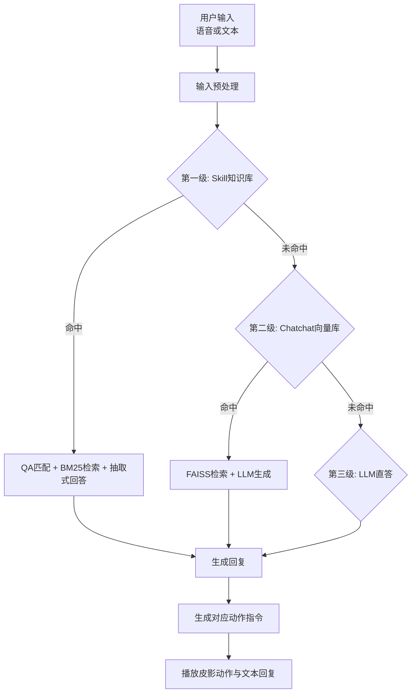

# Chinese Haining Shadow Puppetry with AI interaction 
基于AI交互驱动的海宁皮影戏展示系统
## Requirements

Before running the system, make sure the following components are ready:

1. **Pull the Gemma 3 (4B) model via [Ollama](https://ollama.com):**

```bash
ollama pull gemma3:4b
```

2. **Download the VOSK Chinese speech recognition model:**

- Go to [VOSK Models](https://alphacephei.com/vosk/models)
- Download the model named `vosk-model-cn-0.22`
- Place the unzipped folder inside the `model-cn/` directory in this project:

```
project_root/
├── model-cn/
│   └── vosk-model-cn-0.22/  
```

## Run the system

To start the  system with LLM functionality, run:

```bash
python main.py
```

---

## How to Interact

Once the interface is running, you can interact in two modes:

### Text Mode

- Type Chinese text directly into the input box as a prompt.

###  Voice Mode

- Click the **Text Mode** button to switch to voice interaction.
- Press the **Space** key to start recording.
- Press **Space** again to stop recording.
- The recognized speech will appear in the top-left corner of the screen.

---

## 系统交互流程（用户输入 → 皮影回答）

当前系统的核心流程可以概括为：用户输入 → 语音/文本识别 → 三级混合检索 → 大模型生成回复 → 动作生成 → 皮影表现输出。



### 关键步骤说明
1. 用户通过文本框或语音输入发出请求。
2. 如果是语音输入，会先由 Vosk 进行语音识别，转成文本。
3. **三级混合检索架构**：
   - 第一级：Skill知识库（QA匹配 + BM25检索，510道题库 + 7篇扩展文档）
   - 第二级：LangChain-Chatchat 向量知识库（FAISS检索 + LLM生成）
   - 第三级：大模型直接回答（兜底策略）
4. 生成文本后，再由动作生成器根据意图选择相应的皮影动作，如拱手礼、跳舞、向前走等。
5. 最终把文本回答和动作同步输出，呈现为皮影戏的互动效果。

---

### Some solutions  
## **recommend environment:
Python 3.14.6
pyautogen 0.10.0
## download autogen model
```bash
pip install "autogen-agentchat"
pip install  "autogen-ext[ollama]"
pip install  "autogen-ext[openai]"
```
## System Start Step
1. ## run ollam

```bash
ollama serve   
ollama run gemma3:4b
```
2. ## run project:

```bash
python main.py
```

## reference
https://cloud.tencent.com/developer/article/2542898
https://blog.csdn.net/qq_36894378/article/details/159215006

