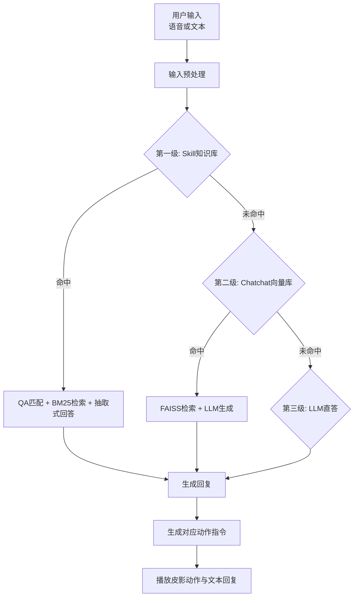

# Chinese Haining Shadow Puppetry with AI Interaction

基于 AI 交互驱动的海宁皮影戏展示系统

---

## 目录

- [运行依赖](#运行依赖)
- [系统交互流程](#系统交互流程用户输入--皮影回答)
- [手势操控与双人偶打斗](#手势操控与双人偶打斗)
- [剧本系统与生成](#剧本系统与生成)
- [分享卡片系统](#分享卡片系统)
- [参考](#参考)
- [主项目环境](#主项目环境)
- [Langchain-Chatchat 本地知识库环境](#langchain-chatchat-本地知识库环境)
- [启动运行](#启动运行)
- [评测体系](#评测体系)
- [多角色皮影素材与调整工具](#多角色皮影素材与调整工具)

---

## 运行依赖

运行系统前，请确保已经准备好以下组件：

### 1. Ollama 大模型

通过 [Ollama](https://ollama.com) 拉取 **Gemma 3 (4B)** 大模型：

```bash
ollama pull gemma3:4b
```

### 2. VOSK 中文语音识别模型

语音模型 `vosk-model-small-cn-0.22` **已随仓库提供**，位于：

```
project_root/
├── model-cn/
│   └── vosk-model-small-cn-0.22/
```

若该目录缺失（或需更换模型），可访问 [VOSK Models](https://alphacephei.com/vosk/models) 下载后解压到 `model-cn/` 下，并保证目录名与 `main.py` 顶部 `VOSK_MODEL_PATH` 一致。

### 3. 语言模式

- 点击 **Text Mode** 按钮切换到语音交互。
- 按下 **空格键** 开始录音。
- 再次按下 **空格键** 结束录音。
- 识别出的语音文本会显示在界面左上角。

### 4. 摄像头手势（可选）

- 安装 `mediapipe`（含 OpenCV）：`pip install mediapipe`；
- 手势模型 `models/hand_landmarker.task` 随仓库提供，缺失时会自动下载；
- 无需摄像头时可不安装，文字/语音功能不受影响。详见 [手势操控与双人偶打斗](#手势操控与双人偶打斗)。

---

## 系统交互流程（用户输入 → 皮影回答）

当前系统的核心流程可以概括为：
**用户输入 → 语音/文本识别 → 三级混合检索 → 大模型生成回复 → 动作生成 → 皮影表现输出。**



### 关键步骤说明

1. 用户通过文本框或语音输入发出请求。
2. 如果是语音输入，会先由 **Vosk** 进行语音识别，转成文本。
3. **三级混合检索架构**：
   - **第一级**：Skill 知识库（QA 匹配 + BM25 知识检索，510 道题库 + 9 篇知识文档），知识命中后用 Ollama 润色组织为自然回答
   - **第二级**：LangChain-Chatchat 向量知识库（FAISS 检索 + LLM 生成）
   - **第三级**：大模型直接回答（兜底策略）
4. **动作指令直通**：纯动作指令（跳舞/行礼/拱手礼/跳跃/抓耳挠腮/向前走/向后走/常态/空闲，以及打戏的 出拳/踢腿/格挡/前冲/后撤/受击、手势词 挥手/捏合/搓手）不进入问答链路，直接播放对应皮影动作。
5. 其余输入生成文本后，由动作生成器根据意图选择相应的皮影动作，如拱手礼、跳舞、向前走等。
6. 最终把文本回答和动作同步输出，呈现为皮影戏的互动效果。

> 说明：文字输入支持系统中文输入法候选框（IME，SDL IME UI）；原地类动作（跳舞/行礼等）播放结束后人物归位到界面中央，移动类动作（向前走/向后走）保持移动后位置且不越出窗口。
> 说明：**剧本模式下**，剧本/分享命令会在进入问答链路前被拦截，详见下方 [剧本系统与生成](#剧本系统与生成) 与 [分享卡片系统](#分享卡片系统)。

---

## 手势操控与双人偶打斗

系统支持**摄像头手势操控**：手势让对应皮影角色做动作，**手的横向位移同时让该角色平移**（拖动式，非行走动作）。

### 常态 vs 手势控制

- **常态（默认）**：只有**一个皮影人物**（居中），用于知识问答，文字/语音均驱动它。
- **开启手势控制**（点击界面「手势控制：关」按钮）：出现**两只皮影左右对峙**——左偶默认「新悟空」，右偶默认「牛魔王」；**左手手势控左偶、右手手势控右偶、双手手势两偶同时做**。再点按钮关闭，回到常态单人并释放摄像头。
- 摄像头画面显示在**主窗口左上角**（带金框与「摄像头预览」标签），不再弹出独立 OpenCV 窗口（避免子线程 GUI 卡死）。

### 手势 → 动作映射

| 手势 | 动作 | 目标 |
|---|---|---|
| 胸口握拳 | 出拳 `punch` | 该手对应角色 |
| 手举过头（张开） | 踢腿 `kick` | 该手对应角色 |
| 平掌推胸前 | 前冲 `lunge` | 该手对应角色 |
| 下压平掌 | 后撤 `retreat` | 该手对应角色 |
| 挥手 | 拱手礼 `greet` | 该手对应角色 |
| 捏合/搓手 | 抓耳挠腮 `scratch` | 该手对应角色 |
| 双手交叉 | 格挡 `block` | **两只同时** |
| 双手护头 | 受击 `hit` | **两只同时** |
| 双拳护胸 | 后撤 `retreat` | **两只同时** |

### 手位移 → 角色平移

- 手势进行时，手的横向位移按比例映射为角色平移（缓动跟手、松手保持），有窗口边界与两偶最小间距约束，防止越界/重叠。
- 可调参数（`main.py` 顶部）：`MOVE_SCALE`（跟手幅度，默认 420）、`DRAG_EASE`（跟手速度，默认 0.18）、`MOVE_DEAD_ZONE`（防抖，默认 0.012）、`MIN_GAP`（两偶最小间距，默认 220）。

### 运行前提

- 主环境需安装 **mediapipe**（含 OpenCV）与手势模型：
  ```bash
  pip install mediapipe
  ```
  模型 `models/hand_landmarker.task` 随仓库提供；缺失时首次运行会尝试自动下载到 `./models/`。
- 缺 mediapipe/OpenCV、无摄像头或模型缺失时，手势功能自动禁用，**不影响**文字/语音问答主链路。
- 摄像头后端会**自动逐个尝试**（DSHOW → MSMF → 默认）并检测黑帧，选用能出画面的后端。
- 排错提示：若手势开启后预览为**纯黑**，通常是**上一个卡死的 `python main.py` 进程仍在占用摄像头**，请在任务管理器结束所有残留的 `python main.py` 后重试。

---

## 剧本系统与生成

主界面右侧有 **「剧本：开 / 关」** 按钮（默认开）。**只有在剧本模式下**，剧本与分享命令才会被拦截；关闭后所有输入交回 Agent 问答链路。

### 剧目库与播放命令

剧目库为 `generated_scripts/classic_plays.json`，内置 5 部西游剧目（闹龙宫、大闹天宫、孙悟空三借芭蕉扇、红孩儿、孙悟空大战牛魔王）。

| 你说 | 效果 |
|---|---|
| `目录` / `列表` | 列出剧目库（按主题分组） |
| `剧本 闹龙宫` | 播放指定剧目 |
| `剧本 西游记` | 从该主题下随机选一部播放 |
| `播放 剧名` / `表演 剧名` | 播放指定剧目 |
| `暂停` / `继续` / `停止` / `状态` | 控制当前演出 |

播放时逐行把动作投给左偶、台词进入输出框并 TTS 播报；界面左上角显示当前剧目与播放/暂停状态。

### 根据用户话语生成剧本

剧目库未收录时，`剧本 X` / `播放 X` 会**自动转为现场生成**；也可显式下达：

```
生成剧本 孙悟空大战二郎神
创作剧本 X   /   编一段 X   /   写个剧本 X   /   生成故事 X
```

生成流程：知识库检索证据 → Ollama 按 JSON 生成结构化剧本（场次 / 角色 / 台词 / 动作 / 时长）→ 动作经 `ACTION_MAP` 映射 → 存档并播放。

- **存储策略**：库内剧目播放**不重复存档**；生成剧本按**内容哈希**存档到 `generated_scripts/<主题>/`（同内容覆盖），并由 `MAX_KEEP_SCRIPTS=50` 超限删旧。
- 生成需要 **Ollama 在线**；离线时提示"暂时无法生成"，不会写文件。

---

## 分享卡片系统

在**剧本模式下**，当你说出含关键词的句子（`分享文案` / `生成分享` / `知识卡片` / `发朋友圈` / `发微博` / `观后感` / `分享`）时，系统生成一张**知识卡片**与一段**分享文案**，供分享到社交媒体。

### 生成流程

1. 从你当前这句话抽取"学习点"（如 `今天学到了海宁皮影戏的历史` → 主题「海宁皮影戏的历史」）。
2. 用知识库检索证据，交给 Ollama 生成**六字段**（标题 / 副标题 / 要点 / 品牌署名 / 分享文案 / 话题标签），严格依据资料、禁止编造。
3. 把文字合成到**预制底图**上，保存 PNG，并在屏幕中央弹层显示；分享文案同时进入输出框并 TTS 播报。

示例输入：

```
帮我生成一个分享文案，今天学到了海宁皮影戏的历史
分享 制作工艺
```

- 点击或按 `Esc` 关闭卡片弹层。
- 离线兜底：Ollama 不可用时用检索证据套模板，**六字段依然齐全**。

### 预制底图与布局 `card_templates/`

- **加底图**：把 PNG/JPG 直接放进 `card_templates/` 即可；也可在 `templates.json` 里**引用已有大图**（如 `workbackground/stage.jpg`、`workbackground/皮影戏舞台背景图抠图.png`），避免重复拷贝占空间。
- **排版**：`layout.json` 为全局默认；`<底图名>.layout.json` 可覆盖（比例坐标 + 字号比例 + 颜色）。
- 已内置：`portrait_3x4.png`（竖版 3:4）及其 `portrait_3x4.layout.json`。

### 成品存储 `share_cards/`

- 文件名 `分享_<主题>_<内容哈希>.png`：**同内容覆盖同一文件**，不重复堆积；
- `MAX_KEEP_CARDS=30`，超出按修改时间删除最旧；
- `share_cards/` 已加入 `.gitignore`（`card_templates/` 会提交）。

> 本功能不引入新的第三方依赖（`pygame`、`openai` 已在用）。

---

## 参考

- [腾讯云开发者社区](https://cloud.tencent.com/developer/article/2542898)
- [CSDN 博客](https://blog.csdn.net/qq_36894378/article/details/159215006)

---

## 主项目环境

- 主要 Python 环境：**3.12.13**
- 在已配置好依赖的 Python 环境中安装所需依赖包：

```bash
pip install aiofiles==25.1.0 annotated-types==0.7.0 anyio==4.14.1 autogen-agentchat==0.7.5 autogen-core==0.7.5 autogen-ext==0.7.5 certifi==2026.6.17 cffi==2.0.0 charset-normalizer==3.4.7 colorama==0.4.6 distro==1.9.0 et_xmlfile==2.0.0 h11==0.16.0 httpcore==1.0.9 httpx==0.28.1 idna==3.18 jiter==0.16.0 jsonref==1.1.0 numpy==2.5.0 ollama==0.6.2 openai==2.44.0 openpyxl==3.1.5 opentelemetry-api==1.43.0 packaging==26.0 pillow==12.2.0 pip==26.1.2 protobuf==5.29.6 pycparser==3.0 pydantic==2.13.4 pydantic_core==2.46.4 pygame==2.6.1 regex==2026.6.28 requests==2.34.2 setuptools==82.0.1 sniffio==1.3.1 sounddevice==0.5.5 srt==3.5.3 tiktoken==0.13.0 tqdm==4.68.3 typing_extensions==4.15.0 typing-inspection==0.4.2 urllib3==2.7.0 vosk==0.3.45 websockets==16.0 wheel==0.47.0 xlrd==2.0.2
```

> 语音识别模型 `vosk-model-small-cn-0.22` **已随仓库提供**（`model-cn/`）；如缺失，可从 [VOSK Models](https://alphacephei.com/vosk/models) 下载后解压到 `model-cn/` 目录。

## Langchain-Chatchat 本地知识库环境

- 推荐使用 Python **3.10.20**，在已配置好依赖的 Python 环境中安装：

```bash
pipx install poetry
cd Langchain-Chatchat/libs/chatchat-server/
poetry install --with lint,test -E xinference
# 或使用 pip 编辑模式安装:
 pip install -e .
```

参考：[Langchain-Chatchat 开发文档](https://github.com/chatchat-space/Langchain-Chatchat/blob/master/docs/contributing/README_dev.md)

---

## 启动运行

> 提示：本仓库不随附一键启动脚本，请按以下命令分别在三个终端中手动启动。

### 第一步：启动知识库后端

在一个窗口终端中执行：

```bash
cd Langchain-Chatchat\libs\chatchat-server
chatchat start --api
```

### 第二步：启动 Ollama

```bash
ollama serve
ollama run gemma3:4b
```

### 第三步：启动主程序

在另一个终端窗口中执行：

```bash
python main.py
```

### 知识库增添文件（第二级 Chatchat 向量库）

1. 确保 chatchat-server 已启动
2. 把文件放入 `kb_inbox/` 目录
3. 运行同步：`python kb_auto_sync.py`
4. 同步脚本会自动创建目标知识库（如不存在）、上传并向量化，删除文件后也会镜像删除

> 说明：项目自带的 `knowledge_base/`（9 篇知识文档 + 题库）用于第一级 Skill 检索，开箱即用；第二级 Chatchat 向量库内容由 `kb_inbox/` 投喂生成。

---

---

## 多角色皮影素材与调整工具

### 角色 = 素材目录 + 独立调参配置

一个角色就是一个含 **10 张标准命名 PNG + `adjust.json`** 的目录：

```
xinwukong_material/          # 新悟空
  body.png  head.png  right_hip.png ...   # 10 个部件
  adjust.json                            # 该角色专属调参
wukong_shadow_play_material/ # 悟空
bull_demon_king_material/    # 牛魔王
sha_wujing_material/         # 沙僧
zhu_bajie_material/          # 猪八戒
shadow_play_material/        # 海宁通用（备用）
```

`adjust.json` 按角色独立保存 **偏移 / 旋转 / 镜像 / 图层 / 枢轴 / 整体朝向**，角色之间互不干扰。

### 角色切换

- 在**调整工具**里按 `Tab` 循环切换角色，选中结果写入根目录 `current_character.txt`；
- 主程序 `python main.py` 启动时自动读取 `current_character.txt` 加载对应角色；
- 也可手动把 `current_character.txt` 内容改成目标目录名。

#### 主程序内切换左右偶角色（双人偶）

- 主界面输入模式按钮上方有 **「左偶：XXX」「右偶：XXX」** 两个按钮，点击在全部角色中循环切换；**Shift+点击反向**。
- 左右偶角色持久化在根目录 `puppet_roles.json`（`{"left": "...", "right": "..."}`），启动时读取；常态下右偶角色按钮只更新"对手角色"，开启手势控制后才显示第二只偶。
- 默认：左偶 `xinwukong_material`、右偶 `bull_demon_king_material`。

### 素材调整工具 `adjust_puppet.py`

傻瓜式可视化校准器（与主程序共用同一渲染管线，`S` 保存到当前角色的 `adjust.json`）：

| 操作 | 按键 |
|---|---|
| 播放 / 暂停、逐帧、切换动作 | 空格、`,` `.`、`[` `]` |
| 轮播全部动作 | `C` |
| 点选部件 / 移动 | 鼠标左键点选 + 拖动 |
| 旋转 | 鼠标右键拖 或 `Q`/`E` |
| 单件镜像 / 全部镜像 | `M` / `L` |
| 整体朝向镜像 | `F` |
| 自动竖直（素材原始角度修正） | `O` |
| 烘焙旋转/镜像写入素材 PNG | `X` |
| 图层（部件前后） | `PageUp` / `PageDown` |
| 复位该部件 / 全部回初始 | `R` / `B` |
| 显示全部标记 / 结构示意图 | `V` / `Y` |
| 保存到当前角色配置 / 退出 | `S` / `ESC` |

窗口可自由拉伸；右上"部件原图"面板可点击设定该部件真正的关节枢轴像素（配合 `O` 自动竖直与 `X` 烘焙，可修正素材初始方向不正的问题）。

### 新增一个角色

```bash
python prepare_character.py <原始素材目录> <输出目录名>
# 例：python prepare_character.py 沙僧 sha_wujing_material
```

- 输出目录名一律用**英文**（如 `bull_demon_king_material`、`sha_wujing_material`），部件 PNG 也是标准英文名；
- 兼容两类命名：按"上/下"分段的（`右胳膊 右手 左腿上 左腿下 …`）与左右部件各自独立的（`右/左胳膊 右/左手 右/左腿 右/左脚 …`）；
- 缺一侧肢体时自动用对侧**镜像补齐**；
- 自动按身体高度统一缩放并生成默认 `adjust.json`；
- 输出目录含 10 张标准图后，会在调整工具 `Tab` 列表中自动出现。

> 注：新悟空的初次锚点重切使用 `prepare_material.py`（含每部件关节锚点可改，重跑即可再生）。
> 原始大图目录（`新孙悟空/`、`怪物/`、`沙僧/`、`猪八戒/`）不入仓库，需要重生成素材时请自行保留原图后运行上述脚本。

### 历史兼容

根目录 `pivot_config.json` 已废弃，改由各角色目录下的 `adjust.json` 承担；首次运行时引擎会把旧文件自动迁入当前角色的 `adjust.json`，原配置不丢失。旧版悟空角色的"肘/肩关节补偿"已按角色启用（仅切到悟空时生效）。
