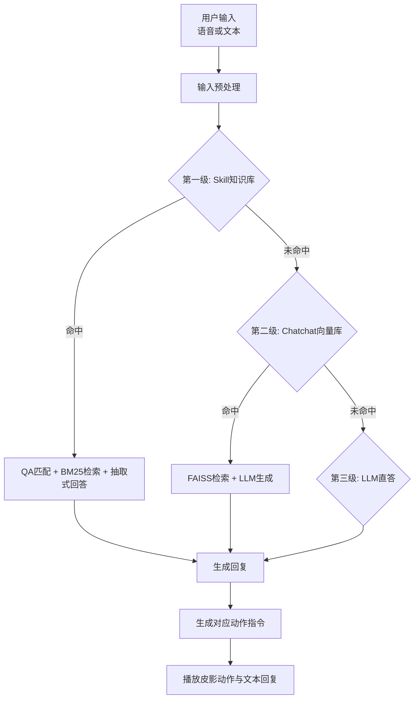

# Chinese Haining Shadow Puppetry with AI Interaction

基于 AI 交互驱动的海宁皮影戏展示系统

---

## 目录

- [运行依赖](#运行依赖)
- [系统交互流程](#系统交互流程用户输入--皮影回答)
- [参考](#参考)
- [主项目环境](#主项目环境)
- [Langchain-Chatchat 本地知识库环境](#langchain-chatchat-本地知识库环境)
- [启动运行](#启动运行)

---

## 运行依赖

运行系统前，请确保已经准备好以下组件：

### 1. Ollama 大模型

通过 [Ollama](https://ollama.com) 拉取 **Gemma 3 (4B)** 大模型：

```bash
ollama pull gemma3:4b
```

### 2. VOSK 中文语音识别模型

- 访问 [VOSK Models](https://alphacephei.com/vosk/models)
- 下载名为 `vosk-model-cn-0.22` 的模型
- 将解压后的模型文件夹放置到项目的 `model-cn/` 目录下：

```
project_root/
├── model-cn/
│   └── vosk-model-cn-0.22/
```

### 3. 语言模式

- 点击 **Text Mode** 按钮切换到语音交互。
- 按下 **空格键** 开始录音。
- 再次按下 **空格键** 结束录音。
- 识别出的语音文本会显示在界面左上角。

---

## 系统交互流程（用户输入 → 皮影回答）

当前系统的核心流程可以概括为：
**用户输入 → 语音/文本识别 → 三级混合检索 → 大模型生成回复 → 动作生成 → 皮影表现输出。**



### 关键步骤说明

1. 用户通过文本框或语音输入发出请求。
2. 如果是语音输入，会先由 **Vosk** 进行语音识别，转成文本。
3. **三级混合检索架构**：
   - **第一级**：Skill 知识库（QA 匹配 + BM25 检索，510 道题库 + 7 篇扩展文档）
   - **第二级**：LangChain-Chatchat 向量知识库（FAISS 检索 + LLM 生成）
   - **第三级**：大模型直接回答（兜底策略）
4. 生成文本后，再由动作生成器根据意图选择相应的皮影动作，如拱手礼、跳舞、向前走等。
5. 最终把文本回答和动作同步输出，呈现为皮影戏的互动效果。

---

## 参考

- [腾讯云开发者社区](https://cloud.tencent.com/developer/article/2542898)
- [CSDN 博客](https://blog.csdn.net/qq_36894378/article/details/159215006)

---

## 主项目环境

- 主要 Python 环境：**3.12.13**
- 所需依赖包（可直接用以下命令安装）：

```bash
pip install aiofiles==25.1.0 annotated-types==0.7.0 anyio==4.14.1 autogen-agentchat==0.7.5 autogen-core==0.7.5 autogen-ext==0.7.5 certifi==2026.6.17 cffi==2.0.0 charset-normalizer==3.4.7 colorama==0.4.6 distro==1.9.0 et_xmlfile==2.0.0 h11==0.16.0 httpcore==1.0.9 httpx==0.28.1 idna==3.18 jiter==0.16.0 jsonref==1.1.0 numpy==2.5.0 ollama==0.6.2 openai==2.44.0 openpyxl==3.1.5 opentelemetry-api==1.43.0 packaging==26.0 pillow==12.2.0 pip==26.1.2 protobuf==5.29.6 pycparser==3.0 pydantic==2.13.4 pydantic_core==2.46.4 pygame==2.6.1 regex==2026.6.28 requests==2.34.2 setuptools==82.0.1 sniffio==1.3.1 sounddevice==0.5.5 srt==3.5.3 tiktoken==0.13.0 tqdm==4.68.3 typing_extensions==4.15.0 typing-inspection==0.4.2 urllib3==2.7.0 vosk==0.3.45 websockets==16.0 wheel==0.47.0 xlrd==2.0.2
```

## Langchain-Chatchat 本地知识库环境

- 推荐使用 Python **3.10.20**

安装步骤：

```bash
pipx install poetry
cd Langchain-Chatchat/libs/chatchat-server/
poetry install --with lint,test -E xinference
# 或使用 pip 编辑模式安装:
pip install -e .
```

参考：[Langchain-Chatchat 开发文档](https://github.com/chatchat-space/Langchain-Chatchat/blob/master/docs/contributing/README_dev.md)

---

## 启动运行

### 第一步：启动知识库后端

在一个窗口终端中执行：

```bash
cd Langchain-Chatchat\libs\chatchat-server
chatchat start --api
```

### 第二步：启动 Ollama

```bash
ollama serve
ollama run gemma3:4b
```

### 第三步：启动主程序

在另一个终端窗口中执行：

```bash
python main.py
```

### 知识库增添文件

1. 添加文件到 `Haining-Shadow-Puppetry-main\kb_inbox` 下
2. 运行 `start_kb_sync.bat`（前提：确保 chatchat-server 已启动）
3. 等待自动添加
