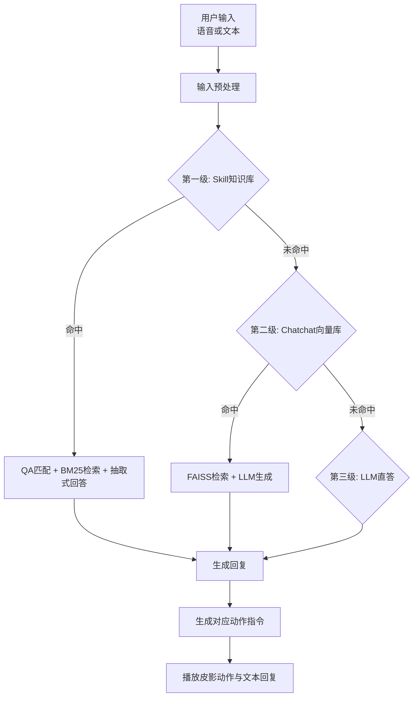

# 海宁皮影数字人交互系统

一种基于大语言模型（Large Language Model, LLM）与检索增强生成（Retrieval-Augmented Generation, RAG）的多代理海宁皮影数字人交互系统。系统提供多模态交互应答反馈，并通过交互手势控制皮影角色表演，为地方传统艺术的活态传承与广泛传播提供了切实可行的技术路径。
---

系统功能主要包括：①多模态输入与应答——用户通过语音或文本输入，系统以语音、文本双通道返回应答，并同步驱动数字人执行跳跃、作揖等体态动作；②手势驱动表演——通过手势识别实现皮影角色出拳、出腿等动作控制；③剧本自动生成——基于大语言模型生成皮影戏表演剧本；④社交分享图片生成——自动生成适用于社交媒体传播的分享图片；⑤视频资料检索——提供海宁皮影相关视频资料的查询与浏览功能。


---

## 目录

- [环境要求](#环境要求)
- [运行依赖](#运行依赖)
- [系统交互流程](#系统交互流程用户输入--皮影回答)
- [手势操控与双人偶打斗](#手势操控与双人偶打斗)
- [剧本系统与生成](#剧本系统与生成)
- [分享卡片系统](#分享卡片系统)
- [本地语音播报（TTS）](#本地语音播报tts)
- [空场伴奏（海宁文化馆录制）](#空场伴奏海宁文化馆录制)
- [视频播放](#视频播放)
- [参考](#参考)
- [主项目环境](#主项目环境)
- [Langchain-Chatchat 本地知识库环境](#langchain-chatchat-本地知识库环境)
- [启动运行](#启动运行)
- [多角色皮影素材与调整工具](#多角色皮影素材与调整工具)
- [目录结构](#目录结构)
- [常见问题（FAQ）](#常见问题faq)
- [许可与仓库](#许可与仓库)

---

## 环境要求

| 项目 | 要求 | 说明 |
|---|---|---|
| 操作系统 | Windows（当前验证环境） | 代码含 `simhei` 回退字体与 `\` 路径写法；未在 Linux/macOS 验证 |
| Python（主程序） | 3.10 | 依赖见 [主项目环境](#主项目环境) |
| Python（知识库后端） | 3.10.20 | 见 [Langchain-Chatchat 本地知识库环境](#langchain-chatchat-本地知识库环境) |
| 大模型 | Ollama + `gemma3:4b` | 动作生成、润色、剧本/分享生成、第三级直答都依赖它 |
| 语音识别 | VOSK `vosk-model-small-cn-0.22` | 已随仓库提供（`model-cn/`） |
| 语音播报（可选） | Piper | 已随仓库提供（`piper/`），缺失时自动静默跳过 |
| 手势（可选） | 摄像头 + mediapipe/OpenCV | 模型已随仓库提供（`models/hand_landmarker.task`） |
| 视频播放（可选） | OpenCV（`opencv-python`） | 视频解码；安装 `mediapipe` 时已一并包含；缺失时视频功能整体不可用 |
| 视频声音（可选） | ffmpeg | 推荐 `pip install imageio-ffmpeg`（自带二进制）；缺失时视频**静音播放**，画面与控制不受影响 |
| 知识库二级检索（可选） | Langchain-Chatchat 服务 | 未启动则跳过第二级，走第一/第三级 |

---

## 运行依赖

运行系统前，请确保已经准备好以下组件：

### 1. Ollama 大模型

通过 [Ollama](https://ollama.com) 拉取 **Gemma 3 (4B)** 大模型：

```bash
ollama pull gemma3:4b
```

### 2. VOSK 中文语音识别模型

语音模型 `vosk-model-small-cn-0.22` **已随仓库提供**，位于：

```
project_root/
├── model-cn/
│   └── vosk-model-small-cn-0.22/
```

若该目录缺失（或需更换模型），可访问 [VOSK Models](https://alphacephei.com/vosk/models) 下载后解压到 `model-cn/` 下，并保证目录名与 `main.py` 顶部 `VOSK_MODEL_PATH` 一致。

### 3. 语音输入（可选）

- 点击界面「**语音模式**」按钮切换到语音交互（按钮文案在「语音模式 / 文字模式」间切换）。
- 按下 **空格键** 开始录音。
- 再次按下 **空格键** 结束录音。
- 识别出的语音文本会短暂显示在界面**右上角**。

### 4. 摄像头手势（可选）

- 安装 `mediapipe`（含 OpenCV）：`pip install mediapipe`；
- 手势模型 `models/hand_landmarker.task` 随仓库提供；缺失时手势功能直接禁用（不会自动下载）；
- 无需摄像头时可不安装，文字/语音功能不受影响。详见 [手势操控与双人偶打斗](#手势操控与双人偶打斗)。

### 5. 视频播放与声音（可选）

视频**解码**依赖 OpenCV，视频**声音**依赖 ffmpeg：

```bash
pip install opencv-python imageio-ffmpeg
```

- **OpenCV**：上一节装 `mediapipe` 时已一并包含，装过可跳过；缺失时视频功能整体不可用。
- **ffmpeg**：`imageio-ffmpeg` 自带 ffmpeg 二进制，**不必再单独安装系统 ffmpeg**；也可以改用系统 `PATH` 上已有的 `ffmpeg`。
- ffmpeg 缺失时，视频**静音播放**：画面、播放控制全部正常，起播时界面会提示一次。详见 [视频播放](#视频播放)。

---

## 系统交互流程（用户输入 → 皮影回答）

当前系统的核心流程可以概括为：
**用户输入 → 语音/文本识别 → 三级混合检索 → 大模型生成回复 → 动作生成 → 皮影表现输出。**



### 关键步骤说明

1. 用户通过文本框或语音输入发出请求。
2. 如果是语音输入，会先由 **Vosk** 进行语音识别，转成文本。
3. **三级混合检索架构**：
   - **第一级**：Skill 知识库（QA 匹配 + BM25 知识检索，510 道题库 + 9 篇知识文档），知识命中后用 Ollama 润色组织为自然回答
   - **第二级**：LangChain-Chatchat 向量知识库（FAISS 检索 + LLM 生成）
   - **第三级**：大模型直接回答（兜底策略）
4. **动作指令直通**：纯动作指令（跳舞/行礼/拱手礼/跳跃/抓耳挠腮/向前走/向后走/常态/空闲，以及打戏的 出拳/踢腿/格挡/前冲/后撤/受击）不进入问答链路，直接播放对应皮影动作。
5. 其余输入生成文本后，由动作生成器根据意图选择相应的皮影动作，如拱手礼、跳舞、向前走等。
6. 最终把文本回答和动作同步输出，呈现为皮影戏的互动效果。

> 说明：文字输入支持系统中文输入法候选框（IME，SDL IME UI）；原地类动作（跳舞/行礼等）播放结束后人物归位到界面中央，移动类动作（向前走/向后走）保持移动后位置且不越出窗口。
> 说明：**剧本模式下**，剧本/分享命令会在进入问答链路前被拦截，详见下方 [剧本系统与生成](#剧本系统与生成) 与 [分享卡片系统](#分享卡片系统)。
> 说明：含"视频"的指令（`视频目录` / `播放视频 <名称>` / `视频本地目录` / `播放本地视频 <文件名>` 等）同样在进入问答链路前被拦截，详见 [视频播放](#视频播放)。

---

## 手势操控与双人偶打斗

系统支持**摄像头手势操控**：手势让对应皮影角色做动作，**手的横向位移同时让该角色平移**（拖动式，非行走动作）。

### 常态 vs 手势交互

- **常态（默认）**：只有**一个皮影人物**（居中），用于知识问答，文字/语音均驱动它。
- **开启手势交互**（点击界面「手势交互：关」按钮）：出现**两只皮影左右对峙**——左偶默认「新悟空」，右偶默认「牛魔王」；**左手手势控左偶、右手手势控右偶**（两只手可同时各自触发动作）。再点按钮关闭，回到常态单人并释放摄像头。
- 摄像头画面显示在**主窗口左上角**（带金框与「摄像头预览」标签），不再弹出独立 OpenCV 窗口（避免子线程 GUI 卡死）。

### 手势 → 动作映射

只保留下列 **4 个单手手势**（刻意不做双手复合手势与挥手/搓手等易误识别的手势）：

| 手势 | 动作 |
|---|---|
| 胸口握拳 | 出拳 `punch` |
| 剪刀手 V（食指+中指伸直分开、其余指弯曲） | 踢腿 `kick` |
| 手刀（四指并拢平伸） | 向前走 `forward` |
| 拇指与食指捏合 | 向后走 `back` |

> 打戏动作（格挡 `block` / 前冲 `lunge` / 后撤 `retreat` / 受击 `hit`）不经摄像头手势触发，只由**文字指令**触发（见上方「动作指令直通」）。

### 手位移 → 角色平移

- 手势进行时，手的横向位移按比例映射为角色平移（缓动跟手、松手保持），有窗口边界与两偶最小间距约束，防止越界/重叠。
- 可调参数（`main.py` 顶部）：`MOVE_SCALE`（跟手幅度，默认 420）、`DRAG_EASE`（跟手速度，默认 0.18）、`MOVE_DEAD_ZONE`（防抖，默认 0.012）、`MIN_GAP`（两偶最小间距，默认 220）。

### 运行前提

- 主环境需安装 **mediapipe**（含 OpenCV）与手势模型：
  ```bash
  pip install mediapipe
  ```
  模型 `models/hand_landmarker.task` 随仓库提供；缺失时手势功能直接禁用（不会自动下载）。
- 缺 mediapipe/OpenCV、无摄像头或模型缺失时，手势功能自动禁用，**不影响**文字/语音问答主链路。
- 摄像头后端会**自动逐个尝试**（DSHOW → MSMF → 默认）并检测黑帧，选用能出画面的后端。
- 排错提示：若手势开启后预览为**纯黑**，通常是**上一个卡死的 `python main.py` 进程仍在占用摄像头**，请在任务管理器结束所有残留的 `python main.py` 后重试。

---

## 剧本系统与生成

主界面右侧有 **「剧本：开 / 关」** 按钮（默认开）。**只有在剧本模式下**，剧本与分享命令才会被拦截；关闭后所有输入交回 Agent 问答链路。

### 剧目库与播放命令

剧目库为 `generated_scripts/classic_plays.json`，内置 5 部西游剧目（闹龙宫、大闹天宫、孙悟空三借芭蕉扇、红孩儿、孙悟空大战牛魔王）。

| 你说 | 效果 |
|---|---|
| `目录` / `列表` | 列出剧目库（按主题分组） |
| `剧本 闹龙宫` | 播放指定剧目 |
| `剧本 西游记` | 从该主题下随机选一部播放 |
| `播放 剧名` / `表演 剧名` | 播放指定剧目 |
| `暂停` / `继续` / `停止` / `状态` | 控制当前演出 |

播放时逐行把动作/台词按角色投给左偶或右偶：剧本开始会自动切换到双偶对峙布局，旁白与主角在左偶、对手在右偶，结束后恢复常态；台词进入输出框并 TTS 播报。界面左上角显示当前剧目与播放/暂停状态。

### 根据用户话语生成剧本

剧目库未收录时，`剧本 X` / `播放 X` 会**自动转为现场生成**；也可显式下达：

```
生成剧本 孙悟空大战二郎神
创作剧本 X   /   编一段 X   /   写个剧本 X   /   生成故事 X
```

生成流程：知识库检索证据 → Ollama 按 JSON 生成结构化的**约 15 句皮影小剧场**（4 场左右 / 角色 / 台词 / 动作 / 时长）→ 动作经 `ACTION_MAP` 映射 → 存档并播放。若模型首版台词过少（少于 10 句），会自动重试一次补足。

- **存储策略**：库内剧目播放**不重复存档**；生成剧本按**内容哈希**存档到 `generated_scripts/<主题>/`（同内容覆盖），并由 `MAX_KEEP_SCRIPTS=50` 超限删旧。
- 生成需要 **Ollama 在线**；离线时提示"暂时无法生成"，不会写文件。

---

## 分享卡片系统

先点击底部 **「分享：关」按钮开启功能**（开启后显示「分享：开」并提示用法）；开启后，当你说出含关键词的句子（`分享文案` / `生成分享` / `知识卡片` / `发朋友圈` / `发微博` / `观后感` / `分享`）时，系统生成一张**知识卡片**与一段**分享文案**，供分享到社交媒体。按钮只负责开关，**不会直接生成卡片**；生成只由关键词触发。**剧本模式下无需点按钮**，直接说出关键词即可触发。

### 生成流程

1. 从你当前这句话抽取"学习点"（如 `今天学到了海宁皮影戏的历史` → 主题「海宁皮影戏的历史」）。
2. 用知识库检索证据，交给 Ollama 生成**六字段**（标题 / 副标题 / 要点 / 品牌署名 / 分享文案 / 话题标签），严格依据资料、禁止编造。
3. 把文字合成到**预制底图**上，保存 PNG，并在屏幕中央弹层显示；分享文案同时进入输出框并 TTS 播报。

示例输入：

```
帮我生成一个分享文案，今天学到了海宁皮影戏的历史
分享 制作工艺
```

- 点击或按 `Esc` 关闭卡片弹层。
- 离线兜底：Ollama 不可用时用检索证据套模板，**六字段依然齐全**。

### 预制底图与布局 `card_templates/`

- **加底图**：把 PNG/JPG 直接放进 `card_templates/` 即可；也可在 `templates.json` 里**引用已有大图**（如 `workbackground/stage.jpg`、`workbackground/皮影戏舞台背景图抠图.png`），避免重复拷贝占空间。
- **排版**：`layout.json` 为全局默认；`<底图名>.layout.json` 可覆盖（比例坐标 + 字号比例 + 颜色）。
- 已内置：`portrait_3x4.png`（竖版 3:4）及其 `portrait_3x4.layout.json`。

### 成品存储 `share_cards/`

- 文件名 `分享_<主题>_<内容哈希>.png`：**同内容覆盖同一文件**，不重复堆积；
- `MAX_KEEP_CARDS=30`，超出按修改时间删除最旧；
- `share_cards/` 已加入 `.gitignore`（`card_templates/` 会提交）。

> 本功能不引入新的第三方依赖（`pygame`、`openai` 已在用）。

---

## 本地语音播报（TTS）

系统用本地 **Piper** 做中文语音合成：所有文本回复、剧本台词、分享文案都会**异步播报**，不阻塞界面。

- 组件已随仓库提供：

  ```
  piper/
  ├── piper/piper.exe              # piper 主程序
  ├── piper/espeak-ng-data/        # espeak-ng 音素数据
  ├── zh_CN-huayan-medium.onnx     # 中文语音模型
  ├── zh_CN-huayan-medium.onnx.json
  └── 集成说明.md
  ```

- 代码入口 `tts_engine.py`：`is_available()` 判断组件是否就绪，`speak_async()` 异步合成并用 `pygame.mixer` 播放；由 `main.py` 在回复/剧本/分享时调用。
- **降级**：`piper/piper/piper.exe` 或 `piper/zh_CN-huayan-medium.onnx` 缺失时，`is_available()` 返回 False，播报自动跳过，**不影响**文字/问答主链路。
- **路径限制**：piper 必须位于**无中文**的路径下，否则 espeak-ng 会报 `Illegal byte sequence`。本仓库把 piper 放在项目根目录 `piper/`，请避免把整个项目放到含中文的路径。

---

## 空场伴奏（海宁文化馆录制）

根目录 `33.全景台.MP3`（约 5 分 21 秒）用于演出空场/观众体验时循环播放。
- `stage_bgm.py` 固定占用 0 号通道（`set_reserved(1)`），不占用 TTS 的 `mixer.music`，也不与视频声音抢通道。
- 视频/剧本/思考/TTS/分享弹层期间自动淡出，结束后淡入；工具栏 ♪ 图标可随时关闭/开启。
- 音量默认 0.15（`stage_bgm.DEFAULT_VOLUME`），觉得响/轻直接改这个常量；替换音频保持同名放根目录即可。

---

## 视频播放

视频播放器 `video_player_system.py` 内嵌在 pygame 主界面中（皮影人站在两侧），**在线片库**与**本机文件**两条来源共用同一套播放、声音与控制逻辑。

### 两条来源

| 来源 | 怎么用 | 需要联网 |
|---|---|---|
| 在线片库（shadow.caa.edu.cn） | 说 `视频目录` 列出、`播放视频 <名称>` 播放 | 是 |
| 本机文件（`download_videos/`） | 把视频文件放进该目录，说 `视频本地目录` 列出、`播放本地视频 <文件名>` 播放 | 否 |

- **在线片库**：首次使用视频功能时申请网络，抓取站点上"海宁"相关的视频标题，列表缓存到根目录 `video_cache.json`（断网也能看到标题列表）。下载的 mp4 与抽出的音轨都落在 `download_videos/`，文件名是内容哈希（如 `3f2a9b1c4d5e.mp4`）。
- **本机文件**：`download_videos/` 里**你自己放进去的**视频（支持 `mp4` / `avi` / `mov` / `mkv` / `flv` / `wmv`，**中文文件名可以**）。名字随便起，匹配是"包含"式的，记不全没关系——文件叫 `海宁皮影·闹龙宫.mp4` 时说 `播放本地视频 闹龙宫` 就能匹配上。

> 两条路**不互通**：在线片库只认它自己下载的哈希名缓存；你手动放进目录的文件必须用 `播放本地视频` 点播，用 `播放视频 <剧目名>` 是找不到它的。

### 播放指令

| 你说 | 效果 |
|---|---|
| `视频目录` / `视频列表` | 列出在线片库的视频标题 |
| `播放视频 <名称>` | 模糊匹配在线片库并播放 |
| `视频本地目录` | 列出 `download_videos/` 里的本机视频文件 |
| `播放本地视频 <文件名>` | 播放本机视频（不联网） |
| `暂停视频` / `继续视频` | 暂停 / 继续 |
| `停止视频` | 停止并退出播放 |
| `视频状态` | 显示当前播放状态 |

> 视频没有独立的界面按钮，全部通过上面的文字/语音指令触发；`暂停` / `快退` / `快进` / `退出` 这几个按钮只在视频**已经播起来之后**才出现在画面上。

### 播放控制

- **鼠标**：画面上方的 暂停 / 快退 / 快进 / 退出 按钮；点进度条任意位置跳转。
- **键盘**：`←` `→` 前后 5 秒，`↑` `↓` 调音量（右上角显示百分比），`Esc` 退出播放。
- **加载中**：下载或抽音轨期间按 `Esc` 可取消。

### 声音

- 视频声音**不走** `pygame.mixer.music`——那是 TTS 占用的全局单例，共用会在 SDL_mixer 内部锁上互相阻塞。视频改用 `pygame.mixer.Sound` + 独立 Channel 播放，两条音频管线互不干扰。
- 声音链路：ffmpeg 抽取音轨 → 转成 44100Hz / 16bit / 双声道 PCM wav → 独立 Channel 播放。音轨同样缓存在 `download_videos/`，同一个视频第二次播放直接复用，不必重新抽取。
- **快进 / 快退 / 拖进度条后声音跟着重定位**，不会与画面错位；画面若落后，按时间轴丢帧追赶，长视频也不会越播越偏。
- 视频播放期间 **TTS 只显示文字、不做语音播报**，避免两条声音叠在一起；起播瞬间若 TTS 还在说话，会先压低视频音量，等它说完自动恢复。
- **首次播放**需要抽音轨（几十 MB 的视频约几秒），期间界面显示「🎵 正在准备视频音轨…」，属正常等待，不是卡死。

### 缓存与回收

- `download_videos/` 已加入 `.gitignore`（视频体积大，不入库）；`video_cache.json` **入库**，作为断网时的标题兜底。
- 启动时自动回收**过期下载产物**：超过 7 天、或总量超过 2GB 时，按修改时间从旧到新清理。
- 回收**只认程序自己生成的哈希命名文件**，你手动放进去的本机视频一律不碰。

### 降级

| 缺失项 | 表现 |
|---|---|
| `opencv` | 视频功能整体不可用 |
| ffmpeg（`imageio-ffmpeg` 与系统 `ffmpeg` 都没有） | **静音播放**，画面与控制正常，起播时界面提示一次 |
| 网络 | 无法获取/下载在线片库的片子；`video_cache.json` 的标题列表仍可查看，**已下载过的剧目可直接重播** |

---

## 参考

- [腾讯云开发者社区](https://cloud.tencent.com/developer/article/2542898)
- [CSDN 博客](https://blog.csdn.net/qq_36894378/article/details/159215006)

---

## 主项目环境

- 主要 Python 环境：**3.10**

### 安装步骤

1. 准备并激活 Python **3.10** 环境（conda / venv 均可）。

2. 在已配置好依赖的 Python 环境中安装所需依赖包：

```bash
pip install aiofiles==25.1.0 annotated-types==0.7.0 anyio==4.14.1 autogen-agentchat==0.7.5 autogen-core==0.7.5 autogen-ext==0.7.5 certifi==2026.6.17 cffi==2.0.0 charset-normalizer==3.4.7 colorama==0.4.6 distro==1.9.0 et_xmlfile==2.0.0 h11==0.16.0 httpcore==1.0.9 httpx==0.28.1 idna==3.18 jiter==0.16.0 jsonref==1.1.0 numpy==2.5.0 ollama==0.6.2 openai==2.44.0 openpyxl==3.1.5 opentelemetry-api==1.43.0 packaging==26.0 pillow==12.2.0 pip==26.1.2 protobuf==5.29.6 pycparser==3.0 pydantic==2.13.4 pydantic_core==2.46.4 pygame==2.6.1 regex==2026.6.28 requests==2.34.2 setuptools==82.0.1 sniffio==1.3.1 sounddevice==0.5.5 srt==3.5.3 tiktoken==0.13.0 tqdm==4.68.3 typing_extensions==4.15.0 typing-inspection==0.4.2 urllib3==2.7.0 vosk==0.3.45 websockets==16.0 wheel==0.47.0 xlrd==2.0.2
```

3. 验证依赖是否装好：

```bash
python -c "import pygame, vosk, sounddevice, numpy, openai, httpx, autogen_agentchat; print('main deps ok')"
```

> 语音识别模型 `vosk-model-small-cn-0.22` **已随仓库提供**（`model-cn/`）；如缺失，可从 [VOSK Models](https://alphacephei.com/vosk/models) 下载后解压到 `model-cn/` 目录。

## Langchain-Chatchat 本地知识库环境

- 推荐 Python 环境：**3.10.20**

### 安装步骤（确保在 `chatchat-server` 目录下）

1. 准备并激活 Python **3.10.20** 环境，安装依赖（poetry 或 pip 二选一）：

   ```bash
   pipx install poetry
   cd Langchain-Chatchat/libs/chatchat-server/
   poetry install --with lint,test -E xinference
   # 或使用 pip 编辑模式安装:
   python -m pip install -e .
   ```

2. 若依赖安装失败或需要重装，先升级 pip 再重新安装：

   ```bash
   python -m pip install --upgrade pip -i https://pypi.tuna.tsinghua.edu.cn/simple
   python -m pip install -e . -i https://pypi.tuna.tsinghua.edu.cn/simple
   ```

3. 验证命令是否可用：

   ```bash
   chatchat --help
   ```

参考：[Langchain-Chatchat 开发文档](https://github.com/chatchat-space/Langchain-Chatchat/blob/master/docs/contributing/README_dev.md)

> 排错提示：如果 **无法通过 `chatchat` 命令启动**，通常说明依赖没有装好（或不在当前环境里），请确认已激活正确的 Python 环境后，重新执行上面的安装步骤。

---

## 启动运行


完整顺序：**安装依赖（1、2）→ 启动服务（3、4）→ 启动主程序（5）**。

1. 安装主项目依赖 → 见 [主项目环境](#主项目环境)
2. 安装知识库后端依赖 → 见 [Langchain-Chatchat 本地知识库环境](#langchain-chatchat-本地知识库环境)
3. 启动知识库后端
4. 启动 Ollama
5. 启动主程序

### 3. 启动知识库后端

在一个窗口终端中执行：

```bash
cd Langchain-Chatchat\libs\chatchat-server
chatchat start --api
```

### 4. 启动 Ollama

```bash
ollama serve
ollama run gemma3:4b
```

### 5. 启动主程序

在另一个终端窗口中执行：

```bash
python main.py
```

### 知识库增添文件（第二级 Chatchat 向量库）

1. 确保 chatchat-server 已启动
2. 把文件放入 `kb_inbox/` 目录
3. 运行同步：`python kb_auto_sync.py`
4. 同步脚本会自动创建目标知识库（如不存在）、上传并向量化，删除文件后也会镜像删除

> 说明：项目自带的 `knowledge_base/`（9 篇知识文档 + 题库）用于第一级 Skill 检索，开箱即用；第二级 Chatchat 向量库内容由 `kb_inbox/` 投喂生成。

---

## 多角色皮影素材与调整工具

### 角色 = 素材目录 + 独立调参配置

一个角色就是一个含 **10 张标准命名 PNG（外加可选的 `adjust.json`）** 的目录：

```
xinwukong_material/          # 新悟空
  body.png  head.png  right_hip.png ...   # 10 个部件
  adjust.json                            # 该角色专属调参
wukong_shadow_play_material/ # 旧悟空（已停用，素材保留）
bull_demon_king_material/    # 牛魔王
sha_wujing_material/         # 旧沙僧（已停用，素材保留）
new_sha_wujing_material/     # 新沙僧（当前使用）
zhu_bajie_material/          # 猪八戒
tang_sanzang_material/       # 唐三藏
new_zhu_bajie_material/      # 新猪八戒
shadow_play_material/        # 海宁通用（已停用，备用）
```

`adjust.json` 按角色独立保存 **偏移 / 旋转 / 镜像 / 图层 / 枢轴 / 整体朝向**，角色之间互不干扰；缺失时使用引擎默认参数。

### 角色切换

- 在**调整工具**里按 `Tab` 循环切换角色，选中结果写入根目录 `current_character.txt`；
- `current_character.txt` 决定渲染引擎 `pygame_Alpha.py` 的默认素材目录（供调整工具与单偶兜底使用）；
- **主程序 `main.py` 的左右偶角色以 `puppet_roles.json` 为准**，见下一节。

#### 主程序内切换左右偶角色（双人偶）

- 主界面输入模式按钮上方有 **「左偶：XXX」「右偶：XXX」** 两个按钮，点击在全部角色中循环切换；**Shift+点击反向**。
- 左右偶角色持久化在根目录 `puppet_roles.json`（`{"left": "...", "right": "..."}`），启动时读取；常态下右偶角色按钮只更新"对手角色"，开启手势交互后才显示第二只偶。
- 仓库内 `puppet_roles.json` 当前为：左偶 `new_sha_wujing_material`（新沙僧）、右偶 `bull_demon_king_material`（牛魔王）；文件缺失时回退到代码默认 `xinwukong_material` / `bull_demon_king_material`。
- 已停用角色（`wukong_shadow_play_material`、`shadow_play_material`、`sha_wujing_material`）素材目录保留在仓库里，但不进入循环列表。

### 素材调整工具 `adjust_puppet.py`

傻瓜式可视化校准器（与主程序共用同一渲染管线，`S` 保存到当前角色的 `adjust.json`）：

| 操作 | 按键 |
|---|---|
| 播放 / 暂停、逐帧、切换动作 | 空格、`,` `.`、`[` `]` |
| 轮播全部动作 | `C` |
| 点选部件 / 移动 | 鼠标左键点选 + 拖动（方向键亦可移动） |
| 旋转 | 鼠标右键拖 或 `Q`/`E` |
| 单件镜像 / 全部镜像 | `M` / `L` |
| 整体朝向镜像 | `F` |
| 自动竖直（素材原始角度修正） | `O` |
| 烘焙旋转/镜像写入素材 PNG | `X` |
| 图层（部件前后） | `PageUp` / `PageDown` |
| 复位该部件 / 全部回初始 | `R` / `B` |
| 大字校准姿势（四肢摊开） | `D` |
| 整体缩放（写入 `SCALE_FACTOR`） | `-` / `=` |
| 按序号选部件 | `0`–`9` |
| 显示全部标记 / 结构示意图 | `V` / `Y` |
| 保存到当前角色配置 / 退出 | `S` / `ESC` |

> 旋转 / 移动时按住 `Shift` 可加速（旋转 5°、位移 10px）。

窗口可自由拉伸；右上"部件原图"面板可点击设定该部件真正的关节枢轴像素（配合 `O` 自动竖直与 `X` 烘焙，可修正素材初始方向不正的问题）。

### 新增一个角色

```bash
python prepare_character.py <原始素材目录> <输出目录名>
# 例：python prepare_character.py 沙僧 sha_wujing_material
```

- 输出目录名一律用**英文**（如 `bull_demon_king_material`、`sha_wujing_material`），部件 PNG 也是标准英文名；
- 兼容三类命名：按"上/下"分段的（`右胳膊 右手 左腿上 左腿下 …`）、左右部件各自独立的（`右/左胳膊 右/左手 右/左腿 右/左脚 …`）、以及只画一侧不带左右的（`胳膊 手臂 大腿 脚 …`，同“新沙僧”）；
- 缺一侧肢体时自动用对侧**镜像补齐**；
- 自动按身体高度统一缩放并生成默认 `adjust.json`；
- 可在原始目录放可选的 `pivots.json`，用源图像素坐标指定关节枢轴和初始旋转（模板见仓库根目录 `pivots.example.json`，复制为 `pivots.json` 放进原始素材目录即可）；
- 输出目录含 10 张标准图后，会在调整工具 `Tab` 列表中自动出现。

> 注：新悟空的初次锚点重切使用 `prepare_material.py`（含每部件关节锚点可改，重跑即可再生；可用 `python prepare_material.py <原始素材目录>` 指定源目录）。
> 原始大图目录（`新孙悟空/`、`怪物/`、`沙僧/`、`猪八戒/`、`新沙僧/`）不入仓库，需要重生成素材时请自行保留原图后运行上述脚本。

### 历史兼容

根目录 `pivot_config.json` 已废弃，改由各角色目录下的 `adjust.json` 承担；首次运行时引擎会把旧文件自动迁入当前角色的 `adjust.json`，原配置不丢失。旧版悟空角色的"肘/肩关节补偿"已按角色启用（仅切到悟空时生效）。

---

## 目录结构

```
Haining-Shadow-Puppetry/
├── main.py                      # 主程序入口（Pygame 界面 / 输入 / 调度）
├── pygame_Alpha.py              # 皮影渲染引擎（素材、枢轴、配置加载）
├── local_knowledge_qa.py        # 第一级本地知识问答引擎（QA + BM25）
├── skill_chatchat_hybrid.py     # 三级混合检索适配器（Skill → Chatchat → 直答）
├── chatchat_adapter.py          # 第二级 Chatchat 后端对接
├── api_client.py                # Chatchat HTTP 客户端
├── chatchat_config.py           # 模型 / 知识库 / 同步配置
├── digital_human_agents_v2.py   # 旧 AutoGen 实现（回退路径）
├── tts_engine.py                # Piper 本地语音播报
├── gesture_recognizer.py        # 摄像头手势识别（MediaPipe）
├── script_player.py             # 剧本播放与生成
├── share_card.py                # 分享卡片与文案生成
├── video_player_system.py       # 视频播放（在线片库 + 本机文件 + 音轨）
├── kb_auto_sync.py              # kb_inbox → Chatchat 向量库同步
├── adjust_puppet.py             # 皮影素材可视化校准工具
├── prepare_character.py         # 通用角色素材生成流水线
├── prepare_material.py          # 新悟空素材锚点重切
├── run_eval.py                  # 黄金评测集回归测试
├── run_eval_500.py              # 500 题基准评测
├── test_run_eval_500.py         # 评测脚本单元测试
├── actions/                     # 动作动画 JSON（greet / dance / punch …）
├── <角色>_material/             # 各角色素材目录（10 PNG + adjust.json）
├── knowledge_base/              # 知识文档（实际加载项以 knowledge-sources.json 为准）
├── knowledge-sources.json       # 知识源清单（role=knowledge/qa 才会被加载）
├── video_cache.json             # 在线视频标题缓存（断网时兜底，入库）
├── generated_scripts/           # 剧目库与生成剧本存档
├── card_templates/              # 分享卡片预制底图与排版
├── models/hand_landmarker.task  # 手势模型
├── model-cn/                    # VOSK 中文语音识别模型
├── piper/                       # 本地 TTS（piper.exe + 中文语音模型）
├── workbackground/              # 舞台背景图
├── Langchain-Chatchat/          # 知识库后端框架
├── share_cards/                 # 分享成品（已 gitignore）
├── download_videos/             # 视频仓库：下载缓存 + 本机视频（已 gitignore）
└── kb_inbox/                    # 二级知识库投放目录（内容 gitignore）
```

> 入库情况：`model-cn/`、`models/`、`piper/`、`card_templates/`、`knowledge_base/`、`generated_scripts/`、`video_cache.json` 与评测数据均在仓库中；`share_cards/`、`download_videos/` 内容、`kb_inbox/` 内容、`start_*.bat`、原始大图目录不入库。
>
> `knowledge_base/` 目录内还含若干参考 PDF；只有 `knowledge-sources.json` 中 `role=knowledge` / `role=qa` 的文件会被引擎加载（当前为 9 篇知识文档 + 1 份题库）。

---

## 常见问题（FAQ）

| 现象 | 原因 / 解决 |
|---|---|
| 手势开启后预览纯黑 | 通常是有残留的 `python main.py` 进程仍在占用摄像头，任务管理器结束全部残留进程后重试 |
| 按空格没有语音识别 | 检查 `model-cn/vosk-model-small-cn-0.22/` 是否存在，且与 `main.py` 的 `VOSK_MODEL_PATH` 一致 |
| 手势按钮点了没反应 | 未安装 `mediapipe`/OpenCV，或 `models/hand_landmarker.task` 缺失；手势功能会直接禁用（不会自动下载） |
| 回复没有声音 / 不播报 | `piper/piper/piper.exe` 或 `piper/zh_CN-huayan-medium.onnx` 缺失；或项目路径含中文导致 espeak-ng 报错 |
| 视频有画面但没声音 | 缺 ffmpeg：`pip install imageio-ffmpeg` 后重启（该包自带二进制）；也可改用系统 `PATH` 上的 `ffmpeg`。都缺失时视频按静音播放 |
| 说 `播放视频 <名称>` 播不出画面 | 断网且该剧目从未下载过。把视频文件放进 `download_videos/` 后用 `播放本地视频 <文件名>` 点播；或联网先播一次，之后即可离线重播 |
| 本机视频怎么放 / 说 `播放本地视频` 没反应 | 文件要放进根目录 `download_videos/`，先 `视频本地目录` 确认能列出，再 `播放本地视频 <文件名>`。视频**没有**独立界面按钮，全靠文字/语音指令触发 |
| 视频卡在「正在准备视频音轨…」 | 首次播放要用 ffmpeg 抽音轨，几十 MB 的视频约几秒，属正常等待；抽完会缓存，第二次直接复用。等太久可按 `Esc` 取消 |
| 第二级检索没有结果 | 未启动 `chatchat start --api`；系统会自动跳过第二级，走第一/第三级 |
| `chatchat` 命令不可用 / 无法启动 | 通常是依赖没装好（或不在当前环境）。在 `chatchat-server/` 下升级 pip 后重跑 `python -m pip install -e .`，再用 `chatchat --help` 验证 |
| 剧本 / 分享生成失败 | 生成依赖 Ollama 在线，离线时不会写文件 |
| `kb_inbox/` 放了文件没生效 | 需运行 `python kb_auto_sync.py`，且 Chatchat 后端已启动 |
| 想更换大模型 | 修改 `chatchat_config.py` 的 `LLM_MODEL` / `ACTION_MODEL`，并 `ollama pull` 对应模型 |

---

## 许可与仓库

- 许可证：**MIT**，见 [LICENSE](LICENSE)（Copyright (c) 2025 QuentinCrane）
- 仓库地址：<https://github.com/xiaoxin33186/Haining-Shadow-Puppetry>
