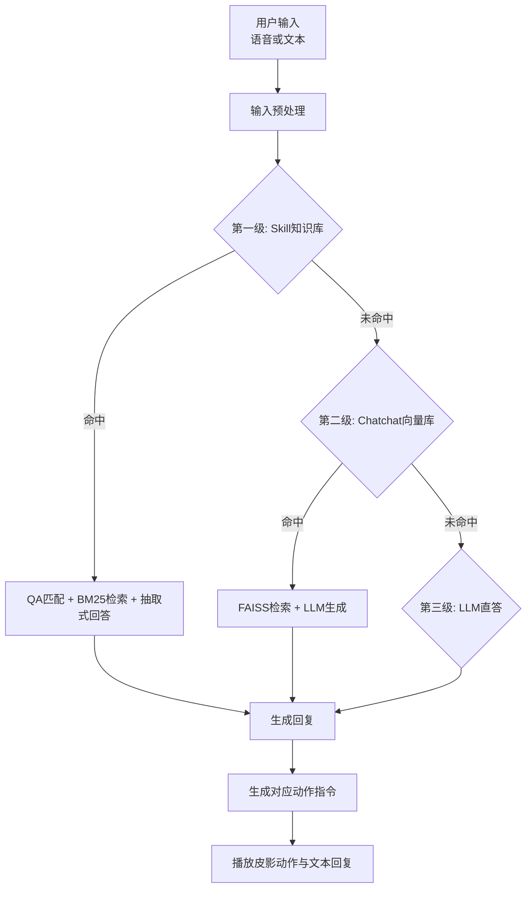

# Chinese Haining Shadow Puppetry with AI interaction 
基于AI交互驱动的海宁皮影戏展示系统
## Requirements

Before running the system, make sure the following components are ready:

1. **Pull the Gemma 3 (4B) model via [Ollama](https://ollama.com):**

```bash
ollama pull gemma3:4b
```

2. **Download the VOSK Chinese speech recognition model:**

- Go to [VOSK Models](https://alphacephei.com/vosk/models)
- Download the model named `vosk-model-cn-0.22`
- Place the unzipped folder inside the `model-cn/` directory in this project:

```
project_root/
├── model-cn/
│   └── vosk-model-cn-0.22/  
```

## Run the system

To start the  system with LLM functionality, run:

```bash
python main.py
```

---

## How to Interact

Once the interface is running, you can interact in two modes:

### Text Mode

- Type Chinese text directly into the input box as a prompt.

###  Voice Mode

- Click the **Text Mode** button to switch to voice interaction.
- Press the **Space** key to start recording.
- Press **Space** again to stop recording.
- The recognized speech will appear in the top-left corner of the screen.

---

## 系统交互流程（用户输入 → 皮影回答）

当前系统的核心流程可以概括为：用户输入 → 语音/文本识别 → 三级混合检索 → 大模型生成回复 → 动作生成 → 皮影表现输出。



### 关键步骤说明
1. 用户通过文本框或语音输入发出请求。
2. 如果是语音输入，会先由 Vosk 进行语音识别，转成文本。
3. **三级混合检索架构**：
   - 第一级：Skill知识库（QA匹配 + BM25检索，510道题库 + 7篇扩展文档）
   - 第二级：LangChain-Chatchat 向量知识库（FAISS检索 + LLM生成）
   - 第三级：大模型直接回答（兜底策略）
4. 生成文本后，再由动作生成器根据意图选择相应的皮影动作，如拱手礼、跳舞、向前走等。
5. 最终把文本回答和动作同步输出，呈现为皮影戏的互动效果。

---

## System Start Step
1. ## run ollam

```bash
ollama serve   
ollama run gemma3:4b
```
2. ## run project:

```bash
python main.py
```

## reference
https://cloud.tencent.com/developer/article/2542898
https://blog.csdn.net/qq_36894378/article/details/159215006

---

## 新海宁影部署攻略

### 主项目环境（新代码项目）
- Python 3.12.13

所需依赖包（可直接用以下命令安装）:
```bash
pip install aiofiles==25.1.0 annotated-types==0.7.0 anyio==4.14.1 autogen-agentchat==0.7.5 autogen-core==0.7.5 autogen-ext==0.7.5 certifi==2026.6.17 cffi==2.0.0 charset-normalizer==3.4.7 colorama==0.4.6 distro==1.9.0 et_xmlfile==2.0.0 h11==0.16.0 httpcore==1.0.9 httpx==0.28.1 idna==3.18 jiter==0.16.0 jsonref==1.1.0 numpy==2.5.0 ollama==0.6.2 openai==2.44.0 openpyxl==3.1.5 opentelemetry-api==1.43.0 packaging==26.0 pillow==12.2.0 pip==26.1.2 protobuf==5.29.6 pycparser==3.0 pydantic==2.13.4 pydantic_core==2.46.4 pygame==2.6.1 regex==2026.6.28 requests==2.34.2 setuptools==82.0.1 sniffio==1.3.1 sounddevice==0.5.5 srt==3.5.3 tiktoken==0.13.0 tqdm==4.68.3 typing_extensions==4.15.0 typing-inspection==0.4.2 urllib3==2.7.0 vosk==0.3.45 websockets==16.0 wheel==0.47.0 xlrd==2.0.2
```

### Langchain-Chatchat 本地知识库环境
- Python 3.10.20

安装步骤:
```bash
pipx install poetry
cd Langchain-Chatchat/libs/chatchat-server/
poetry install --with lint,test -E xinference
# 或使用 pip 编辑模式安装:
pip install -e .
```

参考: https://github.com/chatchat-space/Langchain-Chatchat/blob/master/docs/contributing/README_dev.md

### 启动运行

**第一步：启动知识库后端**
在一个 cmd 窗口中执行:
```bash
cd Langchain-Chatchat\libs\chatchat-server
conda activate chatchat_env
chatchat start --api
```

**第二步：启动主程序**
在另一个 cmd 窗口中执行:
```bash
python main.py
```

