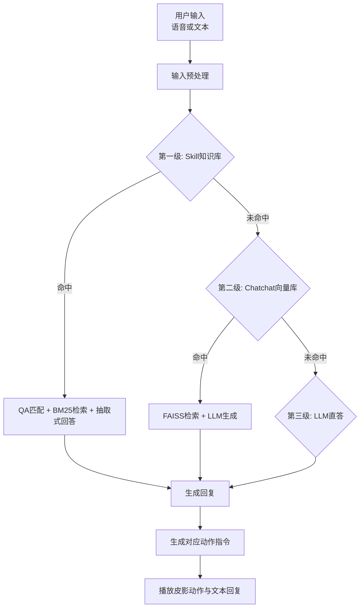

# Chinese Haining Shadow Puppetry with AI Interaction

基于 AI 交互驱动的海宁皮影戏展示系统

---

## 目录

- [运行依赖](#运行依赖)
- [系统交互流程](#系统交互流程用户输入--皮影回答)
- [参考](#参考)
- [主项目环境](#主项目环境)
- [Langchain-Chatchat 本地知识库环境](#langchain-chatchat-本地知识库环境)
- [启动运行](#启动运行)
- [评测体系](#评测体系)

---

## 运行依赖

运行系统前，请确保已经准备好以下组件：

### 1. Ollama 大模型

通过 [Ollama](https://ollama.com) 拉取 **Gemma 3 (4B)** 大模型：

```bash
ollama pull gemma3:4b
```

### 2. VOSK 中文语音识别模型

- 访问 [VOSK Models](https://alphacephei.com/vosk/models)
- 下载名为 `vosk-model-cn-0.22` 的模型
- 将解压后的模型文件夹放置到项目的 `model-cn/` 目录下：

```
project_root/
├── model-cn/
│   └── vosk-model-cn-0.22/
```

### 3. 语言模式

- 点击 **Text Mode** 按钮切换到语音交互。
- 按下 **空格键** 开始录音。
- 再次按下 **空格键** 结束录音。
- 识别出的语音文本会显示在界面左上角。

---

## 系统交互流程（用户输入 → 皮影回答）

当前系统的核心流程可以概括为：
**用户输入 → 语音/文本识别 → 三级混合检索 → 大模型生成回复 → 动作生成 → 皮影表现输出。**



### 关键步骤说明

1. 用户通过文本框或语音输入发出请求。
2. 如果是语音输入，会先由 **Vosk** 进行语音识别，转成文本。
3. **三级混合检索架构**：
   - **第一级**：Skill 知识库（QA 匹配 + BM25 知识检索，510 道题库 + 9 篇知识文档），知识命中后用 Ollama 润色组织为自然回答
   - **第二级**：LangChain-Chatchat 向量知识库（FAISS 检索 + LLM 生成）
   - **第三级**：大模型直接回答（兜底策略）
4. **动作指令直通**：纯动作指令（跳舞/行礼/拱手礼/跳跃/抓耳挠腮/向前走/向后走/常态/空闲）不进入问答链路，直接播放对应皮影动作。
5. 其余输入生成文本后，由动作生成器根据意图选择相应的皮影动作，如拱手礼、跳舞、向前走等。
6. 最终把文本回答和动作同步输出，呈现为皮影戏的互动效果。

> 说明：文字输入支持系统中文输入法候选框（IME，SDL IME UI）；原地类动作（跳舞/行礼等）播放结束后人物归位到界面中央，移动类动作（向前走/向后走）保持移动后位置且不越出窗口。

---

## 参考

- [腾讯云开发者社区](https://cloud.tencent.com/developer/article/2542898)
- [CSDN 博客](https://blog.csdn.net/qq_36894378/article/details/159215006)

---

## 主项目环境

- 主要 Python 环境：**3.12.13**
- 在已配置好依赖的 Python 环境中安装所需依赖包：

```bash
pip install aiofiles==25.1.0 annotated-types==0.7.0 anyio==4.14.1 autogen-agentchat==0.7.5 autogen-core==0.7.5 autogen-ext==0.7.5 certifi==2026.6.17 cffi==2.0.0 charset-normalizer==3.4.7 colorama==0.4.6 distro==1.9.0 et_xmlfile==2.0.0 h11==0.16.0 httpcore==1.0.9 httpx==0.28.1 idna==3.18 jiter==0.16.0 jsonref==1.1.0 numpy==2.5.0 ollama==0.6.2 openai==2.44.0 openpyxl==3.1.5 opentelemetry-api==1.43.0 packaging==26.0 pillow==12.2.0 pip==26.1.2 protobuf==5.29.6 pycparser==3.0 pydantic==2.13.4 pydantic_core==2.46.4 pygame==2.6.1 regex==2026.6.28 requests==2.34.2 setuptools==82.0.1 sniffio==1.3.1 sounddevice==0.5.5 srt==3.5.3 tiktoken==0.13.0 tqdm==4.68.3 typing_extensions==4.15.0 typing-inspection==0.4.2 urllib3==2.7.0 vosk==0.3.45 websockets==16.0 wheel==0.47.0 xlrd==2.0.2
```

> 语音识别模型 `vosk-model-small-cn-0.22` 不随仓库提供，请从 [VOSK Models](https://alphacephei.com/vosk/models) 下载后解压到 `model-cn/` 目录。

## Langchain-Chatchat 本地知识库环境

- 推荐使用 Python **3.10.20**，在已配置好依赖的 Python 环境中安装：

```bash
pipx install poetry
cd Langchain-Chatchat/libs/chatchat-server/
poetry install --with lint,test -E xinference
# 或使用 pip 编辑模式安装:
pip install -e .
```

参考：[Langchain-Chatchat 开发文档](https://github.com/chatchat-space/Langchain-Chatchat/blob/master/docs/contributing/README_dev.md)

---

## 启动运行

> 提示：本仓库不随附一键启动脚本，请按以下命令分别在三个终端中手动启动。

### 第一步：启动知识库后端

在一个窗口终端中执行：

```bash
cd Langchain-Chatchat\libs\chatchat-server
chatchat start --api
```

### 第二步：启动 Ollama

```bash
ollama serve
ollama run gemma3:4b
```

### 第三步：启动主程序

在另一个终端窗口中执行：

```bash
python main.py
```

### 知识库增添文件（第二级 Chatchat 向量库）

1. 确保 chatchat-server 已启动
2. 把文件放入 `kb_inbox/` 目录
3. 运行同步：`python kb_auto_sync.py`
4. 同步脚本会自动创建目标知识库（如不存在）、上传并向量化，删除文件后也会镜像删除

> 说明：项目自带的 `knowledge_base/`（9 篇知识文档 + 题库）用于第一级 Skill 检索，开箱即用；第二级 Chatchat 向量库内容由 `kb_inbox/` 投喂生成。

---

## 评测体系

项目提供两套评测脚本，用于量化回答质量、防止改动引入回归。

### 黄金评测集回归测试（51 题，快速）

```bash
python run_eval.py          # 第一级检索评测（快，不调用 LLM）
python run_eval.py --full   # 全链路评测（含动作生成与润色，较慢）
```

评分：`qa` 命中 1.0 分、`knowledge` 命中 0.7 分、`none` 0 分。

### 500 题基准评测

```bash
python run_eval_500.py --benchmark   # 构建版本化评测基准（首次需 Ollama 在线）
python run_eval_500.py --run         # 运行评测（需 Ollama 在线）
python run_eval_500.py --report      # 生成 Markdown 评测报告
```

- 基准数据：`eval_benchmark_500.json`（300 道题库抽样 + 200 道生成题，均为已生成好的基线）
- 生成题清单：`eval_questions_200.json` / `eval_questions_200.md`
- 生成题证据基线：`eval_generated_evidence.json`
- 运行结果：`eval_results_v4.jsonl`（断点续跑）
- 单元测试：`python -m unittest test_run_eval_500`

> 注意：知识文档集合变化后，`--benchmark` 会按文档指纹自动重建生成题证据基线。
